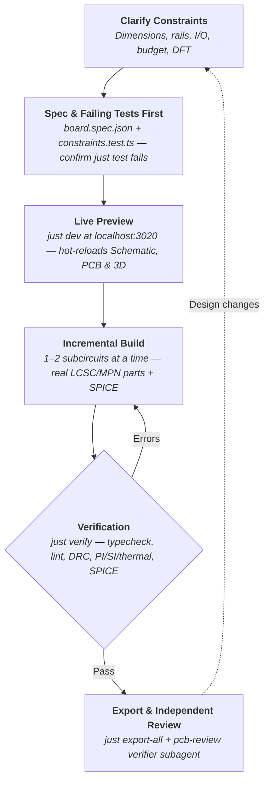

# AgenticBoards (`create-agentic-board`)

Scaffold **fabrication- and assembly-ready PCB projects** designed with AI
coding agents using a **test-driven hardware workflow (TDD)** powered by
**tscircuit**, **ngspice**, **KiCad CLI**, **Freerouting**, **treefmt-nix**,
and **just**.

Works declaratively with **Nix** (`nix run` / `nix flake new` / `shell.nix`) and
independently without Nix (`npx create-agentic-board`), and follows the open
`AGENTS.md` + `.agents/skills/` conventions so it works with any AI coding
agent.

---

## Quick Start

### With Nix (Recommended — Zero Manual Tool Installs)

```bash
nix run github:danimalquackers/AgenticBoards -- my-board
cd my-board
direnv allow      # or `nix develop` / `nix-shell`
just verify
```

_(You can also initialize via Nix flake templates: `nix flake new my-board -t github:danimalquackers/AgenticBoards`.)_

### Without Nix (macOS / Linux / Windows)

Requires **Node.js 22.12+** and **just**; install optional native tools
(`ngspice`, `kicad-cli`, `freerouting`, `biome`, `treefmt`) via your system
package manager (for example `brew install just ngspice biome`, plus KiCad for
`kicad-cli`):

```bash
npx create-agentic-board my-board --no-nix
cd my-board
just doctor       # check installed tools on PATH
just verify
```

---

## How the Test-Driven Workflow Works

Open your scaffolded project in your AI coding agent and describe your board.
`AGENTS.md`, `.agents/skills/`, and `.agents/hooks.json` enforce this loop so
constraints stay verified as the design evolves:



---

## Example Prompts

- **Initial board design:**
  > "Design a 50×35 mm 4-layer USB-C powered RP2040 sensor board with 4× M3
  > mounting holes at the corners, a 3.3V 800mA buck regulator, BME280 I2C
  > sensor, SWD debug header, and ESD protection. Keep total unit BOM under \$12."
- **Major architectural feedback:**
  > "Remove the BME280 subcircuit, add a microSD card slot on SPI0, and shrink
  > the board height to 30 mm."
- **Manufacturing sign-off:**
  > "Run `just export-all` and confirm zero verification or KiCad DRC errors."

---

## Automated Checks Enforced by `just verify`

| Category                                 | Automated Rules                                                                                                                                                                                                                                              |
| :--------------------------------------- | :----------------------------------------------------------------------------------------------------------------------------------------------------------------------------------------------------------------------------------------------------------- |
| **Formatting & Linting (`treefmt-nix`)** | Opinionated Biome rules (`.ts`, `.tsx`, `.js`, `.mjs`, `.json`), Prettier (`.md`, `.yaml`), `nixfmt` (`.nix`), `just --fmt` (`justfile`), `shfmt` + `shellcheck` (`.sh`), plus `tsc --noEmit`                                                                |
| **DRC & Routing**                        | Native Circuit JSON errors, `@tscircuit/checks` (trace overlaps, clearances, via spacing, courtyard overlap, out-of-board parts/traces), zero unrouted airwires (`drc.unrouted_trace`)                                                                       |
| **Mechanical**                           | Max & exact board `width × height` with tolerance, layer count, mounting hole coordinates/diameters, keepout zone overlaps, optional 3D model coverage                                                                                                       |
| **Fab & PCBA**                           | Min trace width, min via drill & outer diameter, copper-to-board-edge clearance (`minEdgeClearanceMm`), footprint coverage, LCSC/MPN part numbers, silkscreen labels                                                                                         |
| **Budget**                               | Every placed component must be priced in `specs/board.spec.json -> budget.bomCosts`; fails if BOM or estimated total unit cost exceeds budget                                                                                                                |
| **Electrical / PI / SI / Thermal**       | Power-to-GND dead-short detection, rail decoupling caps & IC decoupling proximity, IPC-2221 trace ampacity for `maxCurrentA` / `maxTraceTempRiseC`, floating pins, max trace lengths, differential-pair skew (`maxDiffPairSkewMm`), 4-layer stackup advisory |
| **Simulation & Cross-DRC**               | `ngspice` analog simulation probe assertions (`avg`, `min`, `max`, `final`, `ripple`) + independent `kicad-cli pcb drc` error & unconnected-net gate                                                                                                         |

---

## Commands (`just --list`)

All project tasks are standardized through **`just`** (`package.json` holds
dependencies and metadata only):

| Command                                   | Purpose                                                                                  |
| :---------------------------------------- | :--------------------------------------------------------------------------------------- |
| `just dev`                                | Start live tscircuit Schematic / PCB / 3D UI (`http://localhost:3020`)                   |
| `just test`                               | Run TDD constraints, DRC, electrical/SI/PI/thermal & SPICE test suites                   |
| `just check`                              | Run checks and print a full verification scorecard (`dist/checks-report.json`)           |
| `just fmt`                                | Format & auto-fix all file types (`treefmt`, or `biome` fallback)                        |
| `just lint`                               | Check formatting & lint rules without modifying files (`nix flake check` also runs this) |
| `just verify`                             | Full verification gate (`tsc --noEmit` + `just lint` + `just test`)                      |
| `just doctor`                             | Check toolchain binaries on `PATH`                                                       |
| `just export-renders`                     | Export `schematic.svg`, `pcb.svg`, `assembly.svg`                                        |
| `just export-gerbers`                     | Export fabrication `gerbers.zip` (Gerbers + Excellon drills)                             |
| `just export-pcba`                        | Export JLCPCB `bom.csv` & Pick-and-Place CPL `pnp.csv`                                   |
| `just export-kicad`                       | Export `kicad-project.zip`, `board.kicad_pcb`, `board.kicad_sch`                         |
| `just export-3d`                          | Export 3D CAD models (`board.step`, `board.gltf`)                                        |
| `just export-dsn` / `just export-netlist` | Export Specctra `board.dsn` / human-readable `netlist.txt`                               |
| `just export-test-guide`                  | Export `bringup-test-guide.md` (short checks, test-point map, voltage/SI reference)      |
| `just kicad-drc`                          | Run independent `kicad-cli pcb drc` gate on `board.kicad_pcb`                            |
| `just route`                              | Export Specctra DSN and run headless `freerouting` → `dist/routing/board.ses`            |
| `just export-all`                         | Run `verify`, all exports, bring-up guide, and `kicad-drc` for release sign-off          |

---

## Scaffolder CLI Options

Run `create-agentic-board --help` for full usage (powered by `commander`):

```text
create-agentic-board [project-dir] [options]
  --no-nix       Omit Nix and direnv files (flake.nix, shell.nix, treefmt.nix, .envrc)
  --no-git       Skip `git init && git add -A`
  --no-install   Skip running `npm install --legacy-peer-deps`
  -V, --version  Output the version number
  -h, --help     Display help
```

## Repository Structure

- `bin/create-agentic-board.mjs` — `commander`-based Node ESM scaffolder CLI
- `flake.nix`, `treefmt.nix`, `biome.json`, `justfile`, `package.json` — Exposes `apps.default` (`nix run`), `templates.default` (`nix flake new`), `devShells.default`, `formatter` (`nix fmt`), `checks.formatting`, and npm `bin` (`npx`)
- `template/` — Self-contained PCB project (`justfile`, `shell.nix`, `flake.nix`, `treefmt.nix`, `biome.json`, `specs/`, `src/`, `checks/`, `tests/`, `scripts/export-pcba.ts`, `.agents/`)
